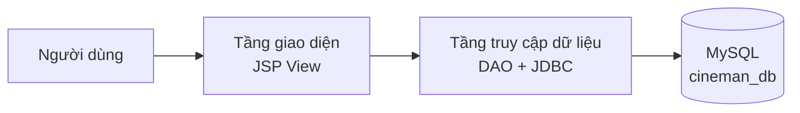

# 🎬 CineMan – Hệ thống quản lý rạp chiếu phim


Đồ án **Phân tích – Thiết kế – Cài đặt** hệ thống quản lý rạp chiếu phim **CineMan**, xây dựng bằng Java Web (JSP/Jakarta EE), Maven và MySQL.

Hệ thống hướng tới ba nhóm người dùng: **Nhân viên quản lý**, **Nhân viên bán hàng** và **Khách hàng**, phục vụ các nghiệp vụ quản lý phim, phòng chiếu, lịch chiếu, bán vé và mua vé trực tuyến.

---

## 📌 Mục lục

- [Tổng quan](#-tổng-quan)
- [Chức năng](#-chức-năng)
- [Công nghệ sử dụng](#-công-nghệ-sử-dụng)
- [Kiến trúc hệ thống](#-kiến-trúc-hệ-thống)
- [Cấu trúc dự án](#-cấu-trúc-dự-án)
- [Cài đặt và chạy](#-cài-đặt-và-chạy)
- [Cơ sở dữ liệu](#-cơ-sở-dữ-liệu)
- [Tài liệu phân tích – thiết kế](#-tài-liệu-phân-tích--thiết-kế)
- [Trạng thái dự án](#-trạng-thái-dự-án)
- [Hướng phát triển](#-hướng-phát-triển)
- [Tác giả](#-tác-giả)

---

## 🎯 Tổng quan

**CineMan** là ứng dụng web hỗ trợ quản lý hoạt động của một rạp chiếu phim:

- Quản lý thông tin phim, phòng chiếu và lịch chiếu.
- Bán vé tại quầy và xuất thẻ thành viên cho khách hàng.
- Cho phép khách hàng tìm kiếm phim, mua vé trực tuyến và thanh toán.
- Thống kê phim, khách hàng và doanh thu.

Dự án được thực hiện theo quy trình:

```text
Đặc tả yêu cầu → Phân tích → Thiết kế → Cài đặt → Kiểm thử
```

---

## ✨ Chức năng

### Đã cài đặt

- ✅ Thêm phim mới vào hệ thống.
- ✅ Hiển thị danh sách phim.
- ✅ Mua vé trực tuyến: chọn phim → chọn suất chiếu → chọn ghế → thanh toán → xuất vé và hóa đơn.
- ✅ Áp dụng ưu đãi 10% khi nhập mã thẻ thành viên hợp lệ.
- ✅ Lưu hóa đơn và danh sách vé trong cùng một transaction.
- ✅ Kết nối MySQL và thao tác dữ liệu qua JDBC/DAO.
- ✅ Giao diện quản lý phim và mua vé bằng JSP.

### Đã phân tích – thiết kế

- 📐 Quản lý thông tin phim: thêm, sửa, xóa.
- 📐 Quản lý phòng chiếu và lịch chiếu.
- 📐 Mua vé trực tuyến: chọn phim → chọn suất chiếu → chọn ghế → thanh toán → in vé và hóa đơn.
- 📐 Quản lý thành viên và thẻ khách hàng thân thiết.
- 📐 Thống kê phim, khách hàng và doanh thu.

### Đang phát triển

- 🚧 Chức năng sửa và xóa phim.
- 🚧 Đăng nhập và phân quyền người dùng.
- 🚧 Kiểm thử tự động cho luồng mua vé.

---

## 🛠 Công nghệ sử dụng

| Thành phần | Công nghệ |
|---|---|
| Ngôn ngữ | Java 17 |
| Web | Jakarta Servlet 6.0, JSP 3.1, JSTL 3.0 |
| Build | Apache Maven |
| Server | Apache Tomcat 10.1+ |
| Cơ sở dữ liệu | MySQL 8.0 |
| Truy cập dữ liệu | JDBC, DAO Pattern |
| Thiết kế | UML, PlantUML |
| Giao diện | JSP, HTML, CSS |

---

## 🏗 Kiến trúc hệ thống

Ứng dụng được tổ chức theo kiến trúc 3 tầng:



- **Controller:** các Servlet trong `servlet4` (`MovieListServlet`, `MovieAddServlet`, `MovieCatalogServlet`, `ShowtimeServlet`, `SeatServlet`, `PaymentServlet`, `InvoiceServlet`).
- **View:** các trang JSP dùng JSTL/EL. Giao diện quản lý bắt đầu từ `CinemaInterface4.jsp`; giao diện khách hàng bắt đầu từ `CustomerInterface4.jsp`. Luồng mua vé gồm `ListMovieInterface4.jsp` → `ShowtimeInterface4.jsp` → `SeatInterface4.jsp` → `PaymentInterface4.jsp` → `ExportInvoiceInterface4.jsp`.
- **DAO:** `DAO`, `MovieDAO4`, `ShowtimeDAO4`, `ScreeningRoomDAO4`, `SeatDAO4`, `MembershipCardDAO4`, `TicketDAO4`, `InvoiceDAO4`.
- **Model:** `Member4`, `Employee4`, `Manager4`, `Customer4`, `SaleStaff4`, `Movie4`, `ScreeningRoom4`, `Showtime4`, `Seat4`, `Ticket4`, `Invoice4`, `MembershipCard4`.

> Định hướng phát triển: tách tầng điều khiển bằng Servlet, áp dụng mô hình MVC đầy đủ và sử dụng connection pool.

---

## 📁 Cấu trúc dự án

```text
CineMan13/
├── pom.xml
├── README.md
├── database/
│   └── cineman.sql
├── src/
│   └── main/
│       ├── java/
│       │   ├── servlet4/
│       │   │   ├── MovieListServlet.java
│       │   │   ├── MovieAddServlet.java
│       │   │   ├── MovieCatalogServlet.java
│       │   │   ├── ShowtimeServlet.java
│       │   │   ├── SeatServlet.java
│       │   │   ├── PaymentServlet.java
│       │   │   └── InvoiceServlet.java
│       │   ├── dao4/
│       │   │   ├── DAO.java
│       │   │   ├── MovieDAO4.java
│       │   │   ├── ShowtimeDAO4.java
│       │   │   ├── ScreeningRoomDAO4.java
│       │   │   ├── SeatDAO4.java
│       │   │   ├── MembershipCardDAO4.java
│       │   │   ├── TicketDAO4.java
│       │   │   └── InvoiceDAO4.java
│       │   └── model4/
│       │       ├── Member4.java
│       │       ├── Employee4.java
│       │       ├── Manager4.java
│       │       ├── Customer4.java
│       │       ├── SaleStaff4.java
│       │       ├── Movie4.java
│       │       ├── ScreeningRoom4.java
│       │       ├── Showtime4.java
│       │       ├── Seat4.java
│       │       ├── Ticket4.java
│       │       ├── Invoice4.java
│       │       └── MembershipCard4.java
│       ├── resources/
│       │   ├── db.properties.example
│       │   └── META-INF/
│       │       └── persistence.xml
│       └── webapp/
│           ├── CinemaInterface4.jsp
│           ├── CustomerInterface4.jsp
│           ├── ManageMovieInterface4.jsp
│           ├── AddMovieInterface4.jsp
│           ├── ListMovieInterface4.jsp
│           ├── ShowtimeInterface4.jsp
│           ├── SeatInterface4.jsp
│           ├── PaymentInterface4.jsp
│           ├── ExportInvoiceInterface4.jsp
│           └── WEB-INF/
│               ├── web.xml
│               └── beans.xml
├── PTTK/
│   ├── Đặc tả/
│   ├── Phân tích (1)/
│   ├── Phân tích full/
│   ├── Thiết kế (1)/
│   ├── Thết kế (2)/
│   ├── Thiết kế (full)/
│   ├── *.puml
│   └── CineMan.xlsx
└── target/                 # Kết quả build (không nên commit)
```

---

## 🚀 Cài đặt và chạy

### 1. Yêu cầu hệ thống

- JDK 17 trở lên
- Maven 3.8+
- MySQL 8.0+
- Apache Tomcat 10.1+ (hỗ trợ Jakarta EE 10)
- NetBeans hoặc IntelliJ IDEA (khuyến nghị)

### 2. Clone dự án

```bash
git clone https://github.com/<username>/CineMan13.git
cd CineMan13
```

### 3. Tạo cơ sở dữ liệu

Chạy script có sẵn:

```bash
mysql -u root -p < database/cineman.sql
```

Script sẽ tạo database `cineman_db`, toàn bộ bảng `tbl...4` và dữ liệu mẫu:

- 2 phim, 2 phòng chiếu, 30 ghế.
- 3 suất chiếu.
- 1 khách hàng demo (`C001`) và thẻ thành viên `LOYAL001`.

> Nếu đã có bảng `Movie4` từ phiên bản cũ, script sẽ tạo lại thành `tblMovie4`. Dữ liệu cũ trong `Movie4` không tự động chuyển sang; cần migrate thủ công nếu muốn giữ.

### 4. Cấu hình kết nối CSDL

Sao chép file mẫu:

```bash
cp src/main/resources/db.properties.example src/main/resources/db.properties
```

Mở `src/main/resources/db.properties` và điền thông tin kết nối:

```properties
db.url=jdbc:mysql://localhost:3306/cineman_db?useSSL=false&allowPublicKeyRetrieval=true&serverTimezone=UTC&characterEncoding=UTF-8
db.username=root
db.password=your_password
```

> File `db.properties` đã nằm trong `.gitignore`, không bị đưa lên GitHub. Chỉ commit file mẫu `db.properties.example`.

### 5. Build dự án

```bash
mvn clean package
```

File WAR được tạo tại:

```text
target/CineManApp-1.0-SNAPSHOT.war
```

### 6. Triển khai lên Tomcat

Sao chép file WAR vào thư mục `webapps` của Tomcat:

```text
<Tomcat>/webapps/CineManApp-1.0-SNAPSHOT.war
```

Khởi động Tomcat, sau đó truy cập:

```text
http://localhost:8080/CineManApp-1.0-SNAPSHOT/CinemaInterface4.jsp
```

### 7. Chạy bằng NetBeans

Mở project bằng NetBeans, cấu hình Tomcat 10.1+ và MySQL, sau đó chọn **Run Project**.

- Giao diện nhân viên quản lý:

```text
http://localhost:8080/CineMan13/CinemaInterface4.jsp
```

- Giao diện khách hàng:

```text
http://localhost:8080/CineMan13/CustomerInterface4.jsp
```

---

## 🗄 Cơ sở dữ liệu

Sơ đồ CSDL và các lớp thực thể được mô tả trong:

- `PTTK/cosodulieu.puml`
- `PTTK/sodollop1.puml`
- `PTTK/sodollop2.puml`
- `PTTK/tongquan.puml`

Các thực thể chính:

| Thực thể | Mô tả |
|---|---|
| `Movie` | Phim được chiếu tại rạp |
| `ScreeningRoom` | Phòng chiếu |
| `Showtime` | Suất chiếu của phim tại phòng |
| `Seat` | Ghế ngồi trong phòng chiếu |
| `Ticket` | Vé xem phim |
| `Invoice` | Hóa đơn thanh toán |
| `Member` | Thành viên hệ thống |
| `Employee` | Nhân viên |
| `Customer` | Khách hàng |
| `LoyalCustomer` | Khách hàng thân thiết |
| `MembershipCard` | Thẻ thành viên |

---

## 📚 Tài liệu phân tích – thiết kế

Toàn bộ tài liệu được lưu trong thư mục `PTTK/`:

| Tài liệu | Nội dung |
|---|---|
| `PTTK/Đặc tả/13B23DCCN584.docx` | Bảng từ khóa, mô tả hệ thống, biểu đồ use case, kịch bản |
| `PTTK/Phân tích (1)/13B23DCCN584.docx` | Kịch bản, trích lớp thực thể, biểu đồ lớp thực thể |
| `PTTK/Phân tích full/13B23DCN584.doc` | Bản phân tích đầy đủ hơn: lớp phân tích, hoạt động, giao tiếp |
| `PTTK/Thiết kế (full)/13B23DCCN584.docx` | Thiết kế lớp, CSDL, giao diện, biểu đồ tuần tự, gói, triển khai |
| `PTTK/*.puml` | Mã PlantUML của các biểu đồ |
| `PTTK/CineMan.xlsx` | Mockup giao diện |

Các biểu đồ UML có thể xem bằng:

- [PlantUML Online Server](https://www.plantuml.com/plantuml/uml/)
- Extension **PlantUML** trên VS Code
- IntelliJ IDEA / NetBeans plugin

---

## 📈 Trạng thái dự án

| Hạng mục | Trạng thái |
|---|---|
| Đặc tả yêu cầu | ✅ Hoàn thành |
| Phân tích hệ thống | 🟡 Cơ bản hoàn thành |
| Thiết kế hệ thống | 🟡 Cơ bản hoàn thành |
| Cài đặt module quản lý phim | ✅ Hoàn thành |
| Cài đặt module mua vé trực tuyến | ✅ Đã cài đặt (demo) |
| Kiểm thử | ⏳ Chưa thực hiện |

---

## 🔮 Hướng phát triển

- [ ] Hoàn thiện chức năng sửa và xóa phim.
- [x] Hoàn thiện module mua vé trực tuyến.
- [ ] Thêm kiểm thử cho luồng mua vé và xử lý tranh chấp ghế.
- [ ] Xây dựng chức năng đăng nhập, đăng xuất và phân quyền.
- [ ] Bổ sung quản lý phòng chiếu, lịch chiếu và thống kê.
- [ ] Chuyển các xử lý JSP scriptlet sang Servlet/Controller.
- [ ] Sử dụng connection pool (HikariCP) thay vì tạo kết nối trực tiếp.
- [ ] Bổ sung kiểm thử đơn vị và kiểm thử chức năng.
- [ ] Đóng gói và triển khai tự động bằng Docker/GitHub Actions.

---

## 👤 Tác giả

- **Họ và tên:** `<Họ và tên sinh viên>`
- **Mã sinh viên:** `B23DCCN584`
- **Lớp:** `<Lớp>`
- **Môn học:** Phân tích – Thiết kế hệ thống thông tin

---

## 📄 Ghi chú

Dự án được xây dựng phục vụ mục đích học tập và làm đồ án môn học. Các tài liệu, biểu đồ và mã nguồn trong repository được sử dụng cho việc nghiên cứu và trình bày quy trình phân tích – thiết kế – cài đặt hệ thống.
